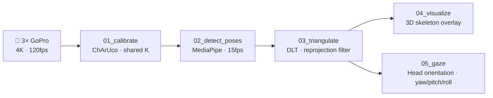

# ScaaleCameraCalib

> Multi-camera 3D skeleton tracking — from raw GoPro footage to gaze-annotated video.


Three synchronized GoPro cameras capture a scene at 4K/120fps. This pipeline calibrates the cameras, detects 33-point body skeletons in each view, triangulates a 3D skeleton via DLT, and estimates head orientation — all the way to an annotated output video.

---

## Pipeline



---

## Hardware Setup

| Component | Spec |
|-----------|------|
| Cameras | 3× GoPro (4K, 120fps, linear lens) |
| Layout | cam01 overhead, cam02 & cam03 side angles |
| ChArUco board | 5×7 squares, 33mm square / 16.5mm marker, `DICT_6X6_250` |
| Audio | Shared audio track used for sub-frame sync via cross-correlation |

---

## Installation

**1. Clone and install dependencies**
```bash
git clone https://github.com/Ramdam17/ScaaleCameraCalib.git
cd ScaaleCameraCalib
poetry install
```

**2. Download the MediaPipe pose model**
```bash
mkdir -p models
curl -L -o models/pose_landmarker_lite.task \
  https://storage.googleapis.com/mediapipe-models/pose_landmarker/pose_landmarker_lite/float16/latest/pose_landmarker_lite.task
```

**3. Add your videos**

Place your footage following the structure defined in `config.json`:
```
data/
  01/  0101.MP4   # cam01 calibration video
       0102.MP4   # cam01 skeleton video
  02/  0201.MP4
       0202.MP4
  03/  0301.MP4
       0302.MP4
  charuco/        # optional: still images of the board
```

---

## Configuration

All parameters live in [`config.json`](config.json). Key fields:

| Section | Field | Default | Description |
|---------|-------|---------|-------------|
| `calibration` | `downscale_width` | 1920 | Resolution for intrinsic calibration |
| `calibration` | `max_frames_per_camera` | 50 | Max ChArUco frames used per camera |
| `pose_detection` | `subsample_fps` | 15 | Detection rate (lower = faster) |
| `pose_detection` | `model_path` | `models/pose_landmarker_lite.task` | MediaPipe model |
| `triangulation` | `max_reprojection_error_px` | 50 | Per-landmark quality gate |
| `triangulation` | `min_cameras_per_point` | 2 | Minimum views required to triangulate |

---

## Usage

Run the scripts in order. Each step reads the output of the previous one.

```bash
# 1. Calibrate intrinsics + stereo extrinsics from ChArUco board footage
poetry run python scripts/01_calibrate.py

# 2. Detect 33-point MediaPipe skeletons (runs all 3 cameras in parallel)
poetry run python scripts/02_detect_poses.py

# 3. Triangulate 2D detections into 3D world coordinates via DLT
poetry run python scripts/03_triangulate.py

# 4. Render skeleton overlay videos (per-camera + composite 2×2 grid)
poetry run python scripts/04_visualize.py

# 5. Estimate head orientation and render gaze arrow overlay
poetry run python scripts/05_gaze.py
```

---

## Outputs

All outputs are written to the `output/` directory.

| File | Script | Description |
|------|--------|-------------|
| `output/calibration/calibration.json` | 01 | Camera intrinsics K, distortion, stereo extrinsics R/T |
| `output/poses/poses_camXX.json` | 02 | Per-frame 2D landmarks for each camera |
| `output/skeleton3d/skeleton3d.json` | 03 | Per-frame 3D landmark positions (world coordinates) |
| `output/visualization/overlay_camXX.mp4` | 04 | Skeleton projected onto each camera view |
| `output/visualization/composite_overlay.mp4` | 04 | 2×2 grid of all three camera overlays |
| `output/gaze/gaze_overlay.mp4` | 05 | Gaze arrow + yaw/pitch/roll annotation |
| `output/gaze/gaze.json` | 05 | Per-frame head orientation angles |

---

## Technical Notes

**Shared intrinsics calibration**
All three cameras are identical GoPros, so intrinsic parameters (K, distortion) are estimated jointly from all ChArUco frames across all cameras. This prevents ill-conditioned per-camera estimates and yields a single robust focal length (~2183px at 1920px width).

**Coordinate space consistency**
Calibration is performed at 1920×1080 (downscaled from 4K). Landmarks are stored and projected in calibration space, then scaled by `video_scale = orig_w / calib_w` before drawing on the 3840×2160 frame.

**Audio sync**
Camera timestamps are aligned via FFT cross-correlation on the first 15 seconds of the shared audio track, achieving sub-frame accuracy (~37ms offset between cameras at 30fps).

**DLT triangulation**
3D points are recovered from ≥2 camera views using the Direct Linear Transform (SVD-based). Landmarks exceeding 50px reprojection error are discarded. Typical result: ~25/33 valid landmarks per frame.

**Head orientation (no frontal camera)**
All cameras are overhead/elevated — MediaPipe FaceLandmarker gives 0% detection at these angles. Instead, head orientation is derived from 3D skeleton face landmarks: `face_normal = cross(right_eye − left_eye, nose − eye_midpoint)`, yielding yaw, pitch, and roll in world coordinates.

---

## Results

| Metric | Value |
|--------|-------|
| Valid frames (triangulation) | 921 / 921 (100%) |
| Average valid landmarks / frame | ~25 / 33 |
| Mean reprojection error | ~12.6 px |
| Head orientation coverage | ~94% of frames |
| Intrinsic RMS | 0.79 px |
| Stereo RMS | 1.7 – 3.2 px |

---

## License

MIT
